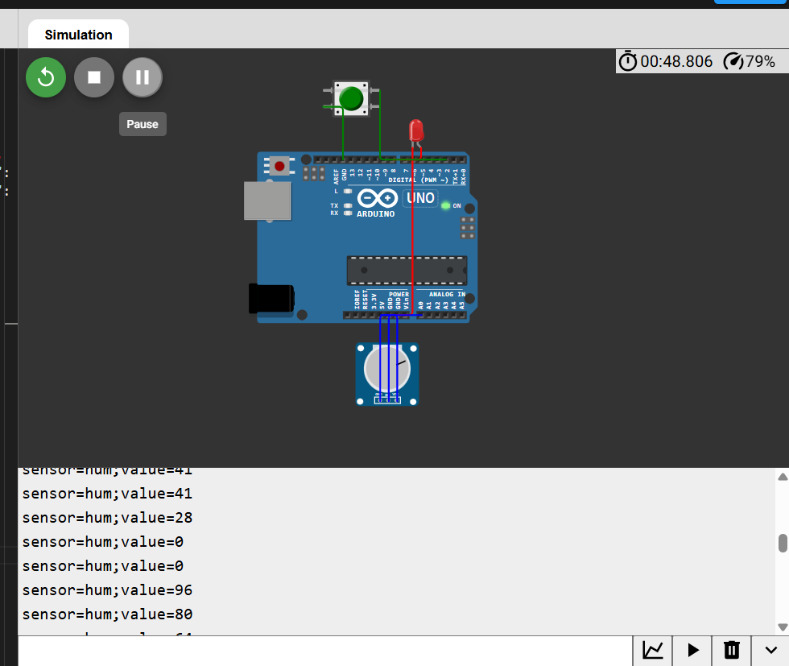
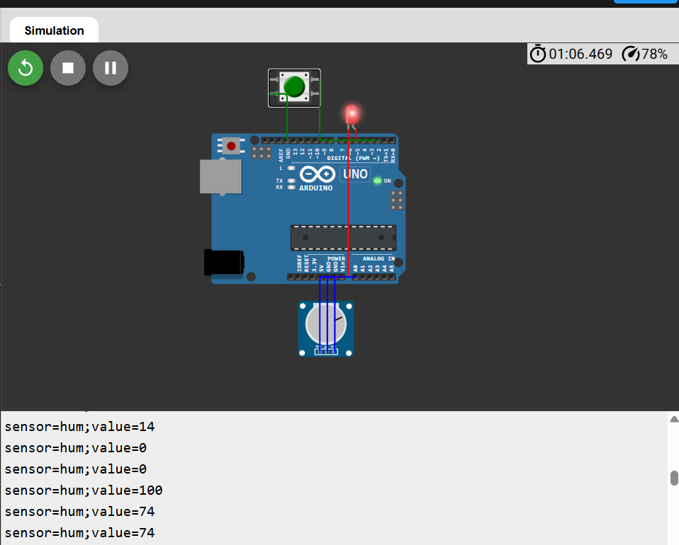

# Практична робота №6. 

**Варіант №3:** Вологість 

**Формат повідомлення:** `sensor=hum;value=XX`


##  Компоненти та схема підключення
- **Arduino Uno**
- **Кнопка (Pushbutton):** 
  - Контакт 1 $\rightarrow$ `Digital Pin 2`
  - Контакт 2 $\rightarrow$ `GND` (використовується режим `INPUT_PULLUP`)
- **Світлодіод (LED):**
  - Анод (+) $\rightarrow$ `Digital Pin 8`
  - Катод (-) $\rightarrow$ `GND`
- **Потенціометр (імітатор датчика вологості):**
  - Лівий контакт $\rightarrow$ `GND`
  - Середній контакт (Signal) $\rightarrow$ `Analog Pin A0`
  - Правий контакт $\rightarrow$ `5V`


##  Повний код скетчу (sketch.ino)

```cpp
const int buttonPin = 2;
const int ledPin = 8;
const int sensorPin = A0;

bool ledState = false;
bool lastButtonState = HIGH;

unsigned long lastMeasurement = 0;
const unsigned long interval = 1000;

void setup() {
  pinMode(buttonPin, INPUT_PULLUP);
  pinMode(ledPin, OUTPUT);
  Serial.begin(9600);
}

void loop() {
  
  bool buttonState = digitalRead(buttonPin);
  if (buttonState == LOW && lastButtonState == HIGH) {
    ledState = !ledState;
    digitalWrite(ledPin, ledState);
  }
  lastButtonState = buttonState;

  
  unsigned long now = millis();
  if (now - lastMeasurement >= interval) {
    lastMeasurement = now;
    
    
    int humValue = map(analogRead(sensorPin), 0, 1023, 0, 100);
    
    
    Serial.print("sensor=hum;value=");
    Serial.println(humValue);
  }
}

```


##  Результати роботи





##  Висновки

Побудова періодичних дій за допомогою `millis()` дозволяє уникнути блокування процесора, забезпечуючи високу чутливість системи до дій користувача (натискання кнопки). Розроблений формат `sensor=hum;value=XX` зручний для подальшого програмного розбору (парсингу) під час передавання даних мережевими протоколами.


##  Відповіді на контрольні запитання
### 1. Для чого призначений режим `INPUT_PULLUP` і чим він відрізняється від зовнішнього підтягувального резистора?
* **Призначення:** `INPUT_PULLUP` вмикає внутрішній підтягувальний резистор мікроконтролера (близько $20\text{--}50\text{ кОм}$), який підтягує вхідний пин до напруги живлення ($5\text{ В}$, рівень `HIGH`), коли кнопка розімкнена.
* **Відмінність:** Зовнішній резистор потрібно фізично запаювати або встановлювати на макетній платі між пином та $5\text{ В}$. Режим `INPUT_PULLUP` виконує цю ж функцію програмно за допомогою внутрішньої апаратури Arduino, спрощуючи схему підключення (кнопку достатньо підключити другим контактом просто до `GND`).

### 2. Яку розрядність має АЦП Arduino Uno і в якому діапазоні значень повертає функція `analogRead()`?
* Вбудований аналого-цифровий перетворювач (АЦП) Arduino Uno має розрядність **10 біт**.
* Функція `analogRead()` повертає ціле число в діапазоні від **0 до 1023** (що відповідає $2^{10} = 1024$ можливим рівням напруги від $0\text{ В}$ до $V_{ref} = 5\text{ В}$).

### 3. Чому використання `delay()` у циклі мікроконтролерної програми вважається проблемним підходом?
* Функція `delay()` є **блокувальною**: вона повністю зупиняє виконання коду мікроконтролера на вказаний час. 
* У цей момент процесор займається «холостим» циклом і не може реагувати на інші події — наприклад, перевіряти натискання кнопок, обробляти сигнали з інших датчиків чи оновлювати ШІМ-сигнали. Це робить систему нечутливою та «зависаючою».

### 4. Чому формат повідомлення, що виводиться через UART, важливо продумати заздалегідь, якщо дані згодом передаватимуться мережею?
* Формат повідомлення визначає протокол обміну даними між пристроями.
* Продумана структура (наприклад, `sensor=hum;value=61` або JSON) містить чіткі роздільники та ключі, що дозволяє серверу або іншому мікроконтролеру легко розібрати (оспарсити) рядок за допомогою програмного коду, уникнути втрати чи спотворення даних і правильно ідентифікувати джерело вимірювання.

### 5. У чому полягає відмінність між синхронним та асинхронним послідовними інтерфейсами передавання даних?
* **Синхронний інтерфейс (наприклад, SPI, I2C):** Використовує окрему фізичну лінію тактування (Clock), за імпульсами якої приймач і передавач синхронізують зчитування кожного біта даних.
* **Асинхронний інтерфейс (наприклад, UART):** Не має окремої лінії тактування. Синхронізація відбувається за рахунок однакової заздалегідь налаштованої швидкості передачі (Baud Rate, наприклад $9600\text{ біт/с}$) та спеціальних стартових/стопових бітів, які огороджують кожен переданий байт даних.

