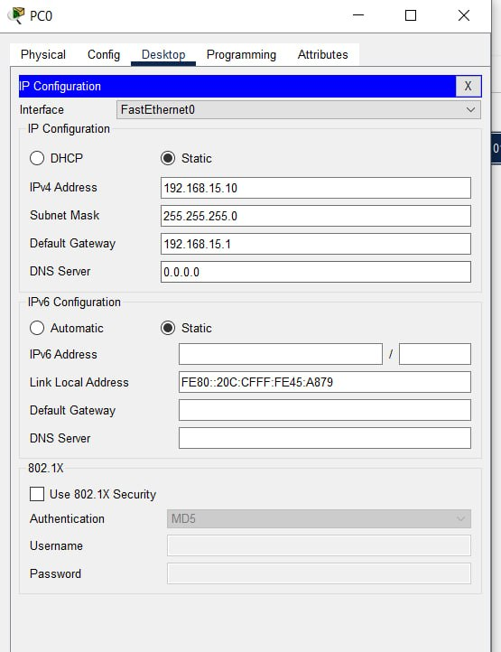
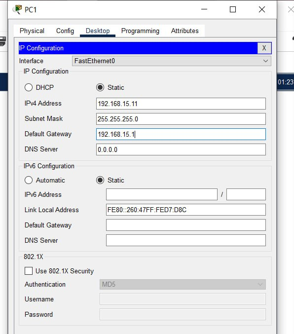
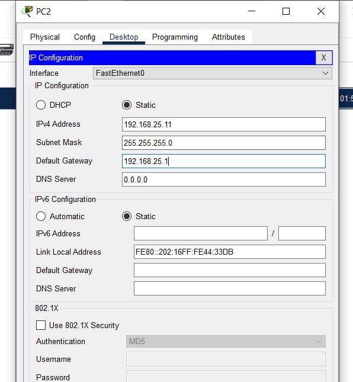
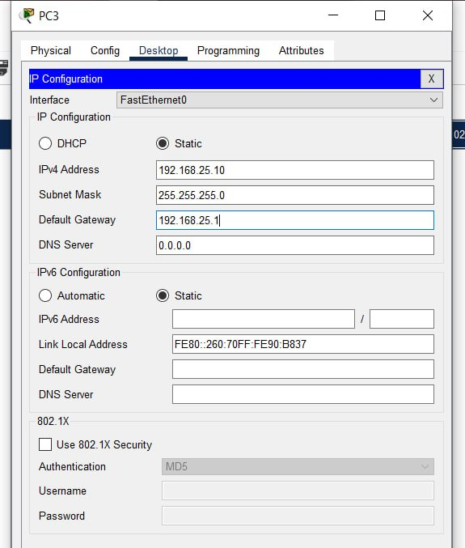
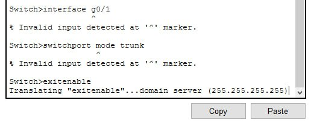
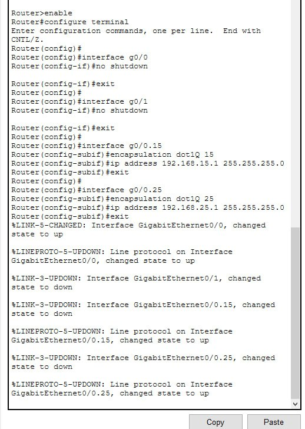
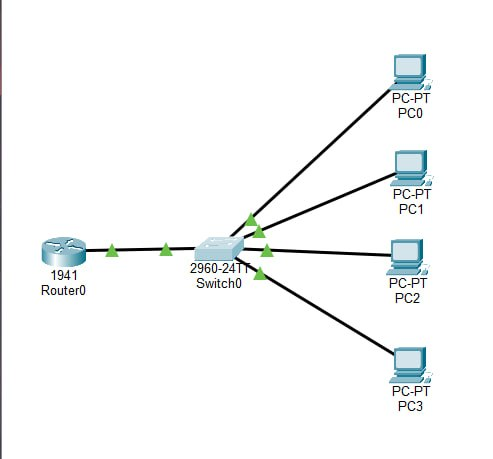
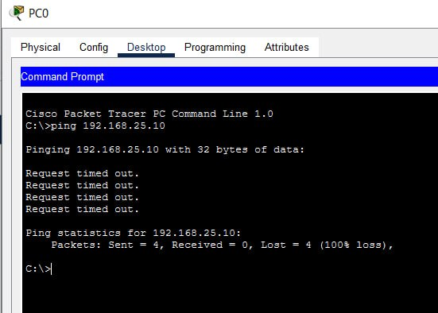

# ЗВІТ з практичної роботи №7 (Варіант 3)

**Тема:** Комутація, VLAN і міжмережева взаємодія

**Студент:** Варіант №3

### Основні дані:

* **VLAN 15 (FIN):** мережа `192.168.15.0/24`, Шлюз: `192.168.15.1`
* **VLAN 25 (QA):** мережа `192.168.25.0/24`, Шлюз: `192.168.25.1`

## 1. Мета роботи

Навчитися розділяти один комутатор на дві окремі ізольовані мережі (VLAN 15 та VLAN 25), щоб комп'ютери всередині них не заважали один одному, а потім налаштувати їхню міжмережеву взаємодію через один кабель роутера (технологія Router-on-a-Stick).

## 2. Таблиця налаштувань пристроїв

| Пристрій | Порт | Віртуальна мережа (VLAN) | IP-адреса | Маска | Шлюз (Router) |
| --- | --- | --- | --- | --- | --- |
| **PC0** | Fa0/1 | VLAN 15 (FIN) | 192.168.15.10 | 255.255.255.0 | 192.168.15.1 |
| **PC1** | Fa0/2 | VLAN 15 (FIN) | 192.168.15.11 | 255.255.255.0 | 192.168.15.1 |
| **PC3** | Fa0/3 | VLAN 25 (QA) | 192.168.25.10 | 255.255.255.0 | 192.168.25.1 |
| **PC2** | Fa0/4 | VLAN 25 (QA) | 192.168.25.11 | 255.255.255.0 | 192.168.25.1 |
| **Router0** | Gi0/0.15 | Субінтерфейс VLAN 15 | 192.168.15.1 | 255.255.255.0 | — |
| **Router0** | Gi0/0.25 | Субінтерфейс VLAN 25 | 192.168.25.1 | 255.255.255.0 | — |

## 3. Короткий опис виконання роботи

1. **З'єднання мережі:** Підключено `PC0` і `PC1` до портів `Fa0/1-2`, а `PC3` і `PC2` — до портів `Fa0/3-4` комутатора. Роутер підключено до порту `Gi0/1`.
2. **Налаштування комутатора:**
* Створено два відділи: `VLAN 15` (FIN) та `VLAN 25` (QA).
* Прикріплено перші два комп'ютери до `VLAN 15`, а наступні два — до `VLAN 25` (режим `access`).
* Порт до роутера (`Gi0/1`) переведено в режим `trunk` для проходження трафіку обох VLAN.

3. **Налаштування роутера:**
* Увімкнено фізичний порт `g0/0` командою `no shutdown`.
* Створено субінтерфейси `g0/0.15` (для VLAN 15) та `g0/0.25` (для VLAN 25) і призначено їм IP-адреси відповідних шлюзів.

## 4. Результати перевірки (Ping)

* **До додавання роутера:** Комп'ютери з одного VLAN (наприклад, `PC0` і `PC1`) успішно обмінювалися пакетами. Спроба відправити ping з `PC0` (VLAN 15) на `PC3` (VLAN 25) завершувалася помилкою `Request timed out`, що підтверджує ізоляцію мереж комутатором.
* **Після додавання роутера:** Сигнал `ping 192.168.25.10` з `PC0` проходить успішно (`Reply from 192.168.25.10`). Міжмережевий зв'язок налаштовано коректно.

## 5. Висновок

Створення VLAN дозволило розділити один фізичний комутатор на дві незалежні та ізольовані віртуальні мережі. Комп'ютери з різних VLAN не бачать один одного напряму. Для маршрутизації трафіку між ними використано роутер: він приймає пакет з VLAN 15, перевіряє IP-адресу призначення та пересилає його у VLAN 25.

## 6. Відповіді на контрольні запитання

1. **Як комутатор вивчає MAC-адреси і що робить з невідомим листом?**
Комутатор аналізує MAC-адресу відправника кожного кадру, запам'ятовує її та прив'язує до номера порту в своїй MAC-таблиці. Якщо пакет призначений для невідомої адреси, комутатор розсилає його на всі порти (окрім порту-джерела), чекаючи на відповідь від потрібного пристрою.
2. **Чому широкомовний лист з одного VLAN не потрапляє в інший?**
Оскільки VLAN створює ізольований широкомовний домен. Усі широкомовні запити розповсюджуються тільки всередині свого VLAN і не виходять за його межі.
3. **Чим порт доступу (access) відрізняється від транкового (trunk)?**
* **Access-порт** належить тільки одній VLAN і передає нетегований трафік кінцевих пристроїв (ПК, принтери).
* **Trunk-порт** передає трафік декількох VLAN одночасно між мережевими пристроями (комутатор-комутатор або комутатор-роутер) і додає до кожного кадру тег із номером VLAN.

4. **Що таке тег 802.1Q і навіщо він потрібен?**
Це цифровий заголовок з номером VLAN, який додається до кадру при русі через транковий кабель. Він потрібен пристроям, щоб розрізняти, до якої саме віртуальної мережі належить пакет.
5. **Що простіше: Router-on-a-stick чи SVI?**
`Router-on-a-stick` простіший та дешевший для малих мереж, бо використовує один фізичний роутер і один кабель з субінтерфейсами. `SVI` (Switch Virtual Interface) налаштовується прямо на L3-комутаторі й забезпечує значно вищу швидкість маршрутизації.
6. **Чому без роутера ПК з різних VLAN не бачили один одного?**
Тому що вони знаходяться в різних IP-мережах і різних широкомовних доменах. L2-комутатор передає дані тільки всередині однієї мережі; для зв'язку між різними IP-мережами обов'язково потрібен пристрій 3-го рівня (роутер).

## 7. Домашнє завдання

1. **Чому широкомовний кадр пішов на всі порти, а звичайний — на один?**
Широкомовний кадр використовує спеціальну адресу призначення `FF:FF:FF:FF:FF:FF` («для всіх»), тому комутатор дублює його на всі активні порти VLAN. Звичайний (unicast) кадр призначений конкретному пристрою, і якщо комутатор має запис у MAC-таблиці, він відправляє його точково лише на відповідний порт.
2. **Чому ARP-запит не проходить між VLAN і що робити?**
ARP-запит є широкомовним запитом. Оскільки VLAN обмежує широкомовний трафік у межах однієї віртуальної мережі, ARP-запит з VLAN 15 не може потрапити у VLAN 25. Щоб пристрої з різних VLAN знаходили один одного, у топологію додають роутер (або L3-комутатор), а на ПК вказують IP-адресу роутера як основний шлюз (Default Gateway).

Скріни роботи:

