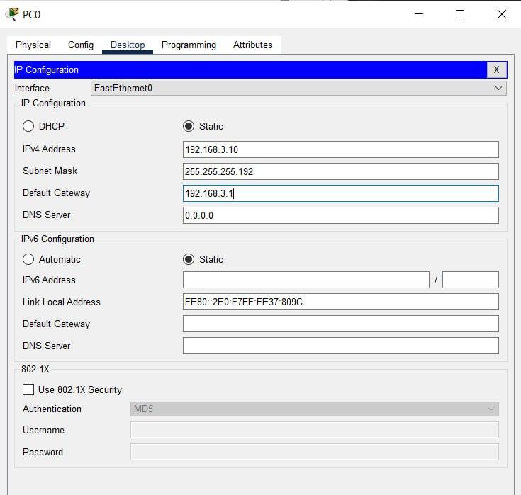
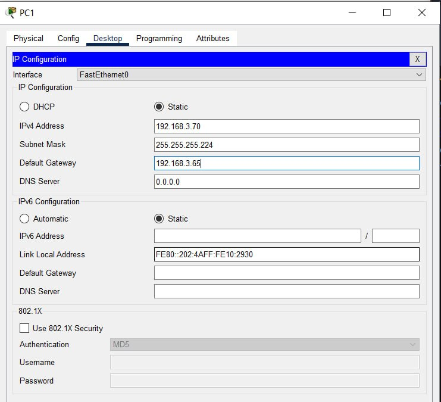
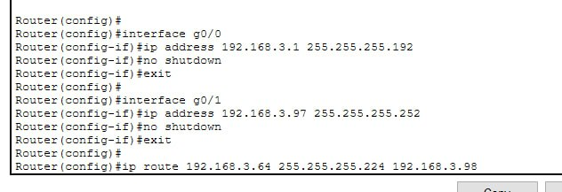
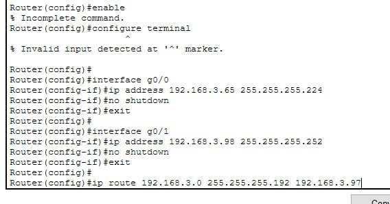
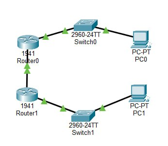
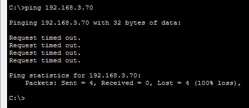

# ЗВІТ


**Варіант:** №3

**Базова мережа:** `192.168.3.0/24`

**Вимоги до підмереж:** Підмережа А — 50 вузлів, Підмережа Б — 25 вузлів, P2P — 2 вузли

**Інструмент:** Cisco Packet Tracer


## 1. Мета роботи

Опанувати обчислення IP-адрес, навчитися ділити мережу на рівні частини та за допомогою методу VLSM під конкретні потреби, а також перевірити працездатність схеми в Cisco Packet Tracer.


## 2. Крок 1. Параметри базової мережі

* **Адреса мережі:** `192.168.3.0`
* **Маска:** `255.255.255.0` (`/24`)
* **Широкомовна адреса:** `192.168.3.255`
* **Діапазон придатних адрес:** `192.168.3.1` – `192.168.3.254`
* **Загальна кількість адрес:** 256 (придатних для пристроїв — 254)


## 3. Крок 2. Поділ на 2 підмережі однакового розміру

Для поділу базової мережі `/24` навпіл запозичується 1 біт. Нова маска — `/25` (`255.255.255.128`). Кожна підмережа отримує по 128 адрес.

* **Підмережа 1:**
* **Адреса мережі:** `192.168.3.0/25` (Маска: `255.255.255.128`)
* **Діапазон адрес:** `192.168.3.1` – `192.168.3.126`
* **Широкомовна адреса:** `192.168.3.127`


* **Підмережа 2:**
* **Адреса мережі:** `192.168.3.128/25` (Маска: `255.255.255.128`)
* **Діапазон адрес:** `192.168.3.129` – `192.168.3.254`
* **Широкомовна адреса:** `192.168.3.255`


## 4. Крок 3. Поділ методом VLSM (Таблиця Варіанта 3)

Розрахунок ведеться від найбільшої потреби до найменшої: **А (50) $\rightarrow$ Б (25) $\rightarrow$ P2P (2)**.

| Підмережа | Потреба (вузлів) | Префікс | Адреса мережі | Маска | Діапазон придатних адрес | Широкомовна адреса |
| --- | --- | --- | --- | --- | --- | --- |
| **А** | 50 | `/26` | `192.168.3.0` | `255.255.255.192` | `192.168.3.1` – `192.168.3.62` | `192.168.3.63` |
| **Б** | 25 | `/27` | `192.168.3.64` | `255.255.255.224` | `192.168.3.65` – `192.168.3.94` | `192.168.3.95` |
| **P2P** | 2 | `/30` | `192.168.3.96` | `255.255.255.252` | `192.168.3.97` – `192.168.3.98` | `192.168.3.99` |

* **Використано:** 100 адрес із 256.
* **Вільний резервний блок:** `192.168.3.100` – `192.168.3.255` (156 адрес для майбутнього розширення).


## 5. Таблиця адресації пристроїв у Packet Tracer

| Пристрій | Інтерфейс | IP-адреса | Маска підмережі | Основний шлюз |
| --- | --- | --- | --- | --- |
| **Router0** | `g0/0` (Шлюз А) | `192.168.3.1` | `255.255.255.192` | — |
| **Router0** | `g0/1` (P2P) | `192.168.3.97` | `255.255.255.252` | — |
| **Router1** | `g0/0` (Шлюз Б) | `192.168.3.65` | `255.255.255.224` | — |
| **Router1** | `g0/1` (P2P) | `192.168.3.98` | `255.255.255.252` | — |
| **PC0** | `Fa0` (Сегмент А) | `192.168.3.10` | `255.255.255.192` | `192.168.3.1` |
| **PC1** | `Fa0` (Сегмент Б) | `192.168.3.70` | `255.255.255.224` | `192.168.3.65` |


## 6. Скрипти конфігурації обладнання

### Команди для Router0 (Верхній роутер):

```cisco
enable
configure terminal

interface g0/0
 ip address 192.168.3.1 255.255.255.192
 no shutdown
 exit

interface g0/1
 ip address 192.168.3.97 255.255.255.252
 no shutdown
 exit

ip route 192.168.3.64 255.255.255.224 192.168.3.98

```

### Команди для Router1 (Нижній роутер):

```cisco
enable
configure terminal

interface g0/0
 ip address 192.168.3.65 255.255.255.224
 no shutdown
 exit

interface g0/1
 ip address 192.168.3.98 255.255.255.252
 no shutdown
 exit

ip route 192.168.3.0 255.255.255.192 192.168.3.97

```


## 7. Результати перевірки (Ping)

При перевірці зв'язку з комп'ютера `PC0` на комп'ютер `PC1` за допомогою команди:

```bash
ping 192.168.3.70

```

Отримано успішний результат:
`Reply from 192.168.3.70: bytes=32 time<1ms TTL=126`

Зв'язок між підмережами А та Б через канал P2P налаштовано правильно.


## 8. Висновки

Використання методу VLSM дозволило гнучко та економно виділити IP-адреси під різну кількість комп’ютерів у підмережах (50, 25 та 2 вузли) без марнування IP-простору. Завдяки налаштуванню статичних маршрутів між роутерами досягнуто повної міжмережевої зв’язності.


## 9. Відповіді на контрольні запитання

1. **Чому для визначення адреси мережі застосовують побітову операцію «І» (AND)?**
Операція AND обнуляє частину адреси, яка відповідає за конкретний комп'ютер (вузол), залишаючи недоторканою частину мережі. Це дозволяє маршрутизатору точно визначити номер усієї мережі.
2. **Що станеться з кількістю адрес, якщо перейти від маски `/24` до `/25`?**
Кількість доступних для пристроїв адрес зменшиться вдвічі — замість 254 залишиться 126.
3. **У чому різниця між рівним поділом та VLSM?**
При рівному поділі всі підмережі отримують однакову маску та однаковий розмір. У VLSM кожна підмережа отримує свою маску, підлаштовану під її реальні потреби.
4. **Чому підмережі у VLSM виділяють від найбільшої до найменшої?**
Великим підмережам потрібні великі блоки адрес, які мають бути вирівняні по межах свого розміру. Якщо почати з дрібних, між блоками з'являться порожні нерозподілені «фрагменти» (діри).
5. **Навіщо для P2P обирають маску `/30`?**
Маска `/30` дає усього 2 придатні адреси — саме стільки, скільки потрібно для з'єднання двох маршрутизаторів між собою.

Скріни:





