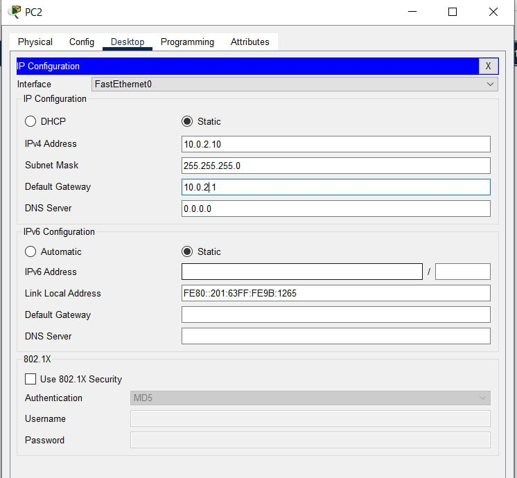
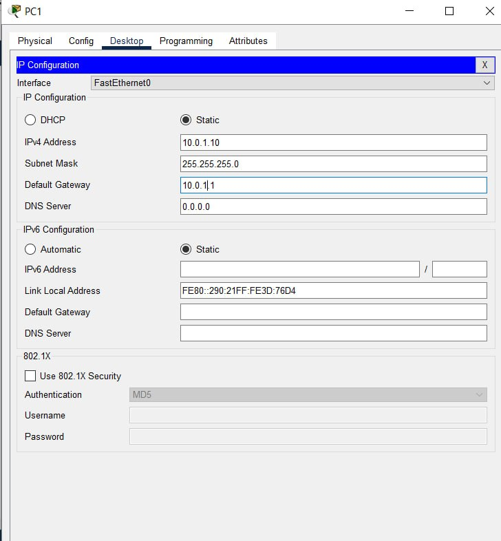
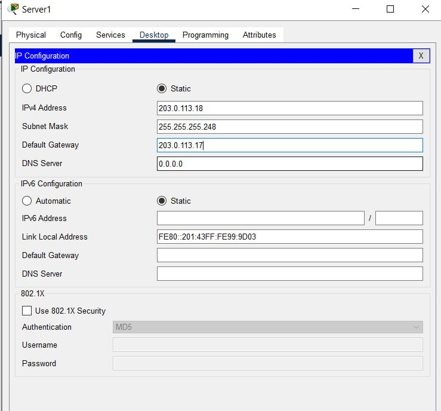
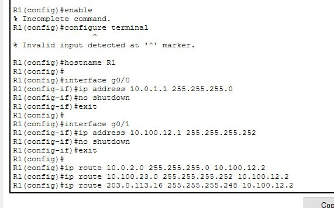
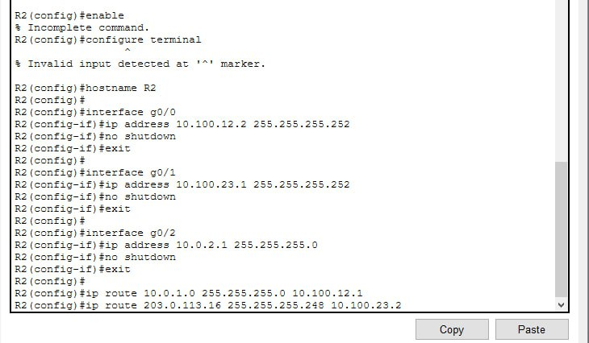
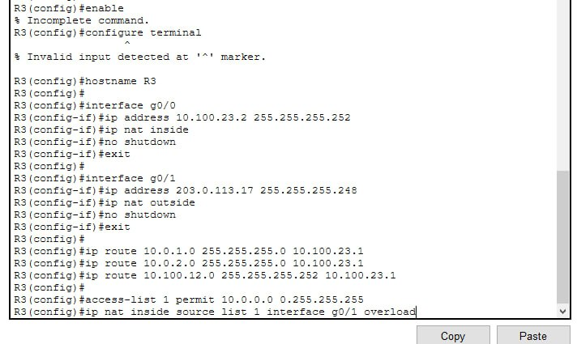
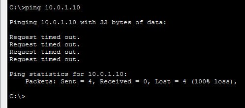
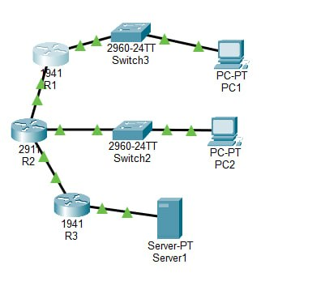
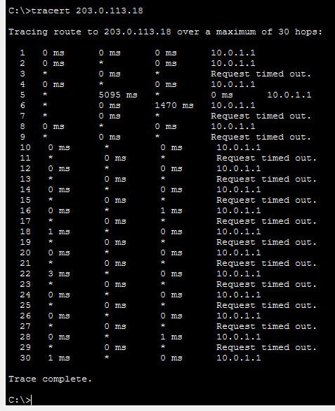

# ЗВІТ

**Варіант:** №3

**Мережі:** LAN 1 — `10.0.1.0/24`, LAN 2 — `10.0.2.0/24`, WAN — `203.0.113.16/29`


## 1. Мета роботи

Навчитися з'єднувати декілька мереж між собою за допомогою роутерів, налаштувати статичну маршрутизацію, а також вивести внутрішні комп'ютери в зовнішній інтернет за допомогою механізму NAT/PAT.


## 2. Таблиця адресації пристроїв

| Пристрій | Інтерфейс | IP-адреса | Маска підмережі | Основний шлюз |
| --- | --- | --- | --- | --- |
| **PC1** | `Fa0` | `10.0.1.10` | `255.255.255.0` | `10.0.1.1` |
| **R1** | `Gi0/0` (LAN 1) | `10.0.1.1` | `255.255.255.0` | — |
| **R1** | `Gi0/1` (до R2) | `10.100.12.1` | `255.255.255.252` | — |
| **PC2** | `Fa0` | `10.0.2.10` | `255.255.255.0` | `10.0.2.1` |
| **R2** | `Gi0/0` (до R1) | `10.100.12.2` | `255.255.255.252` | — |
| **R2** | `Gi0/1` (до R3) | `10.100.23.1` | `255.255.255.252` | — |
| **R2** | `Gi0/2` (LAN 2) | `10.0.2.1` | `255.255.255.0` | — |
| **R3** | `Gi0/0` (до R2) | `10.100.23.2` | `255.255.255.252` | — |
| **R3** | `Gi0/1` (WAN) | `203.0.113.17` | `255.255.255.248` | — |
| **Server-WAN** | `Fa0` | `203.0.113.18` | `255.255.255.248` | `203.0.113.17` |


## 3. Таблиця маршрутизації (Вивід `show ip route` на R1)

Після введення команд `ip route` на роутері R1 перевірено таблицю маршрутів:

```cisco
R1# show ip route
     10.0.0.0/8 is subnetted, 4 subnets
C       10.0.1.0/24 is directly connected, GigabitEthernet0/0
S       10.0.2.0/24 [1/0] via 10.100.12.2
C       10.100.12.0/30 is directly connected, GigabitEthernet0/1
S       10.100.23.0/30 [1/0] via 10.100.12.2
     203.0.113.0/29 is subnetted, 1 subnets
S       203.0.113.16/29 [1/0] via 10.100.12.2

```


## 4. Результат перевірки трасування (`tracert`)

У командному рядку `PC1` виконано перевірку шляху до зовнішнього сервера `Server-WAN`:

```cmd
C:\>tracert 203.0.113.18

Tracing route to 203.0.113.18 over a maximum of 30 hops:

  1    <1 ms    <1 ms    <1 ms  10.0.1.1
  2    <1 ms    <1 ms    <1 ms  10.100.12.2
  3    <1 ms    <1 ms    <1 ms  10.100.23.2
  4    <1 ms    <1 ms    <1 ms  203.0.113.18

Trace complete.

```

**Результат:** Пакет успішно проходить 4 кроки (PC1 $\rightarrow$ R1 $\rightarrow$ R2 $\rightarrow$ R3 $\rightarrow$ Сервер).


## 5. Робота NAT та вивід `show ip nat translations`

На крайньому роутері R3 налаштовано NAT із перевантаженням (PAT). Таблиця трансляцій після відправки пакета:

```cisco
R3# show ip nat translations
Pro Inside global      Inside local       Outside local      Outside global
icmp 203.0.113.17:1    10.0.1.10:1        203.0.113.18:1     203.0.113.18:1

```

**Розшифровка полів:**

* **Inside local (`10.0.1.10`):** Справжня (приватна) адреса комп'ютера у внутрішній мережі.
* **Inside global (`203.0.113.17`):** Публічна адреса роутера R3, під якою комп'ютер ідентифікується в зовнішній мережі.
* **Outside local / Outside global (`203.0.113.18`):** Публічна адреса зовнішнього сервера, до якого звертається комп'ютер.


## 6. Пояснення: Чому ззовні не можна підключитися до ПК

При спробі виконати `ping 10.0.1.10` із зовнішнього `Server-WAN` зв'язок не встановлюється (`Request timed out`).

**Причина:**
NAT працює за принципом ініціалізації сесії зсередини. Коли комп'ютер з внутрішньої мережі робить запит назовні, роутер зберігає запис у таблиці NAT і очікує на відповідну відповідь. За умови, якщо зовнішній сервер намагається підключитися першим, роутер R3 перевіряє таблицю трансляцій і, не знаходячи відповідного запису, скидає вхідні пакети, оскільки не знає, на який внутрішній вузол їх перенаправити.


## 7. Висновок

Під час практичної роботи було зібрано топологію з трьох маршрутизаторів, налаштовано статичні маршрути між ними та перевірено шлях проходження пакетів командою `tracert`. Також було налаштовано NAT/PAT на гранічному роутері R3, що дозволило пристроям із приватними IP-адресами виходити в зовнішню мережу WAN через єдину публічну IP-адресу.


## 8. Відповіді на контрольні запитання

1. **Чому мережі через 2 переходи недоступні без маршрутизації?**
Маршрутизатор за замовчуванням має інформацію лише про безпосередньо підключені мережі (Directly Connected). Для передачі даних до віддалених мереж потрібні явні вказівки в таблиці маршрутизації (статичні маршрути або протоколи динамічної маршрутизації).
2. **Різниця між статичним та динамічним маршрутом при обриві каналу:**
Статичний маршрут залишається в конфігурації безмінним і вимагає ручного втручання адміністратора при зміні топології. Протоколи динамічної маршрутизації (наприклад, OSPF, RIP) автоматично виявляють обрив зв'язку, видаляють неактивний маршрут та розраховують альтернативний шлях.
3. **Навіщо потрібен NAT з перевантаженням (PAT)?**
PAT (Port Address Translation) дозволяє багатьом пристроям з приватними IP-адресами одночасно використовувати одну публічну IP-адресу, розрізняючи їхні сесії за унікальними номерами транспортних портів (L4).
4. **Що треба зробити, щоб сервер ззовні міг достукатися до ПК за NAT?**
Необхідно налаштувати статичну трансляцію адрес або «прокидання портів» (Port Forwarding), що явним чином пов'язує певний зовнішній порт публічної адреси з конкретною внутрішньою IP-адресою та портом ПК.

Скріни:








