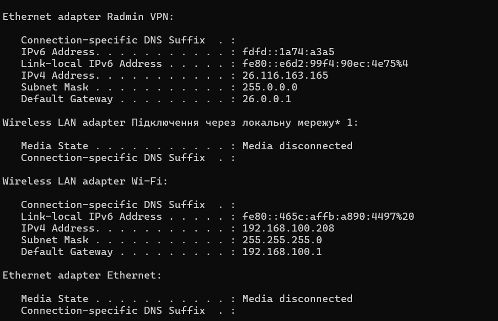

# Звіт з самостійної роботи №11
**Тема:** IPv6: адресація і механізми переходу

**Предмет:** Комп'ютерні та мікропроцесорні системи, організація комп'ютерних мереж

**Варіант:** 3

### Завдання 1. Скорочення IPv6-адреси

* **Початкова адреса:** `ff02:0000:0000:0000:0000:0000:0000:0001`

* **Крок 1 (Видалення провідних нулів u кожній групі):**
`ff02:0:0:0:0:0:0:1`

* **Крок 2 (Заміна найдовшої послідовності нульових блоків на `::`):**
`ff02::1`

* **Скорочений вигляд:** `ff02::1`

### Завдання 2. Визначення типу адреси

 **Тип адреси:** **Multicast (багатоадресна / групова адреса)**
 **Обґрунтування:**
Перший хекстет (блок) адреси — `ff02`. Усі Multicast-адреси в IPv6 починаються з префікса **`ff`** (у двійковому форматі це біти `1111 1111`). Конкретно адреса `ff02::1` використовується для надсилання пакетів усім вузлам (All Nodes) у межах локального сегмента мережі (link-local scope).

### Завдання 3. Поділ префікса на 16 підмереж

* **Початковий префікс:** `2001:0db8:1234::/48`

* **Нова маска підмережі:** `/48 + 4 біти = /52` (один шістнадцятковий символ у 4-му блоці).

* **Крок зміни 4-го блоку:** збільшується від `0` до `f` (16 значень: 0, 1, 2, ..., 9, a, b, c, d, e, f).

**Перелік підмереж:**

 **Перша підмережа (0):** `2001:0db8:1234:0000::/52` (або `2001:db8:1234::/52`)

 **Друга підмережа (1):** `2001:0db8:1234:1000::/52` (або `2001:db8:1234:1000::/52`)
 **Третя підмережа (2):** `2001:0db8:1234:2000::/52` (або `2001:db8:1234:2000::/52`)
 ...
 **Остання (16-та) підмережа (f):** `2001:0db8:1234:f000::/52` (або `2001:db8:1234:f000::/52`)

### Завдання 4. Власна IPv6-адреса та механізм її отримання

(Щоб отримати власні дані, відкрий командний рядок / Термінал у Windows і введи `ipconfig`, або в Linux/Mac введи `ip -6 addr`).

**Приклад заповнення:**

* **Знайдена адреса:** `fe80::884a:3bf0:12cd:45ef%12`
* **Тип адреси:** **Link-local** (починається з `fe80`).

* **Механізм отримання:** **SLAAC (Stateless Address Autoconfiguration)** — адреса згенерована пристроєм автоматично на основі MAC-адреси мережевого адаптера або випадкового ідентифікатора для зв'язку в межах однієї локальної мережі.

### Відповіді на контрольні запитання 

1. **Скільки разів у межах однієї адреси можна використати позначення `::` і чому?**
 Лише **один раз**. Якщо використати `::` двічі (наприклад, `fe80::1::2`), буде неможливо визначити, скільки саме нульових блоків пропущено в першому місці, а скільки в другому.

2. **За якими бітами адреси можна одразу впізнати link-local i multicast адреси?**
* **Link-local:** починаються з перших 10 біт `1111 1110 10` (у шістнадцятковій формі — префікс `fe80::/10`).

* **Multicast:** починаються з перших 8 біт `1111 1111` (у шістнадцятковій формі — префікс `ff00::/8`).

3. **Чим унікальна локальна адреса (ULA) відрізняється від глобальної unicast-адреси за призначенням?**
* **ULA (префікс `fc00::/7` або `fd00::/7`):** використовується **лише всередині локальної мережі** організації і не маршрутизується в глобальному Інтернеті (аналог приватних IPv4-адрес на кшталт `192.168.x.x`).

* **Глобальна unicast (префікс `2000::/3`):** використовується для безпосереднього доступу та маршрутизації в глобальній мережі **Інтернет** (аналог публічних IPv4-адрес).

4. **Що змінилося в заголовку IPv6 порівняно з IPv4 і чому прибрали контрольну суму заголовка?**
 Заголовок IPv6 зробили фіксованим розміром (40 байтів), прибрали другорядні/застарілі поля (IHL, Identification, Flags, Fragment Offset, Option). Контрольну суму (Header Checksum) прибрали тому, що контроль помилок вже виконується на канальному рівні (Ethernet/Wi-Fi) та на транспортному рівні (TCP/UDP). Це дозволило маршрутизаторам значно швидше обробляти й пересилати пакети.