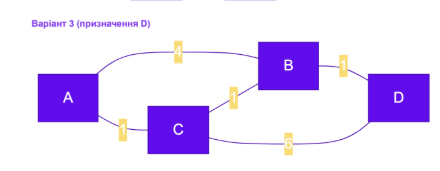

# Звіт з самостійної роботи №12

 
**Варіант:** №3 (Джерело: $A$, Призначення: $D$)  

## Завдання 1. Пошук шляху за кількістю переходів (hop count, як у RIP)

У протоколі RIP метрикою є кількість переходів (маршрутизаторів на шляху). Вага кожного ребра вважається рівною $1$.

* **Найкоротший шлях:** $A \rightarrow B \rightarrow D$
* **Кількість переходів (Hop count):** 2

## Завдання 2. Пошук шляху за сумою ваг (як у OSPF) — Алгоритм Дейкстри

Протокол OSPF враховує вартість (пропускну здатність) кожного каналу. Для знаходження найоптимальнішого шляху використовується алгоритм Дейкстри.

### Покрокова таблиця виконання алгоритму Дейкстри:

| Крок | Відвіданий вузол | Відстань до A | Відстань до B | Відстань до C | Відстань до D | Пояснення / Дія |
| :---: | :---: | :---: | :---: | :---: | :---: | :--- |
| **0** | — | **0** | $\infty$ | $\infty$ | $\infty$ | Початковий стан (джерело $A$) |
| **1** | **A** | 0 | 4 (через A) | **1 (через A)** | $\infty$ | Оновлюємо сусідів $B (4)$ та $C (1)$. Обираємо найменший: $C$ |
| **2** | **C** | 0 | **2 (через C)** | 1 | 7 (через C) | З $C$ до $B$: $1+1=2$ ($<4$, оновлюємо); до $D$: $1+6=7$. Обираємо: $B$ |
| **3** | **B** | 0 | 2 | 1 | **3 (через B)** | З $B$ до $D$: $2+1=3$ ($<7$, оновлюємо). Обираємо: $D$ |
| **4** | **D** | 0 | 2 | 1 | **3** | Досягнуто вузол призначення $D$ |

* **Підсумковий оптимальний шлях:** $A \rightarrow C \rightarrow B \rightarrow D$
* **Підсумкова вартість (сума ваг):** $1 + 1 + 1 = 3$

## Завдання 3. Порівняльний аналіз результатів

Отримані шляхи **різняться**: протокол RIP вибрав шлях $A \rightarrow B \rightarrow D$ (2 переходи, загальна вага $4 + 1 = 5$), а OSPF — шлях $A \rightarrow C \rightarrow B \rightarrow D$ (3 переходи, загальна вага $1 + 1 + 1 = 3$). 

Вузол розходження — **вузол $A$**, де RIP одразу обирає прямий канал на $B$, ігноруючи його низьку пропускну здатність (вага 4). RIP орієнтується виключно на мінімізацію кількості роутерів, тоді як OSPF знаходить більш вигідний маршрут з точки зору сумарної затримки/вартості каналів, навіть якщо він містить більше intermediate-вузлів.

## Завдання 4. Порівняльна таблиця протоколів та особливості BGP

### Порівняльна таблиця (RIP, OSPF, BGP):

| Характеристика | RIP | OSPF | BGP |
| :--- | :--- | :--- | :--- |
| **Тип алгоритму** | Дистанційно-векторний (Distance Vector) | Стан каналу (Link-State) | Вектор шляху (Path-Vector) |
| **Метрика** | Кількість переходів (Hop count, макс. 15) | Вартість каналу (Cost / Bandwidth) | Політики, довжина списку AS (AS-Path) |
| **Область застосування** | Малі локальні мережі (LAN) | Внутрішні мережі підприємств/провайдерів (IGP) | Міжавтономна маршрутизація, Інтернет (EGP) |
| **Швидкість збіжності** | Низька (до кількох хвилин) | Висока (секунди) | Середня / Налаштовувана |
| **Масштабованість** | Низька | Висока (в межах однієї AS) | Глобальна (весь Інтернет) |

### Чому міжавтономна маршрутизація потребує окремого протоколу BGP:

Міжавтономна маршрутизація вимагає BGP з двох основних причин. По-перше, це **масштаб таблиці маршрутів**: глобальний Інтернет налічує понад мільйон префіксів, і жоден внутрішній протокол (як OSPF) не здатен обробити такий обсяг даних без вичерпання ресурсів маршрутизаторів. По-друге, це **роль договірних відносин (peering, transit)**: передача даних між автономними системами визначається не найкоротшою технічною відстанню, а економічними та політичними угодами між провайдерами, що вимагає гнучкого регулювання маршрутів за допомогою політик BGP.

### Відповіді на контрольні запитання (для захисту)

1. **Чому RIP та OSPF можуть обрати різні маршрути?**
Тому що RIP рахує лише кількість роутерів на шляху (переходи), а OSPF оцінює реальну пропускну здатність (вагу) кожного каналу.

2. **Опишіть один крок алгоритму Дейкстри своїми словами.**
На кожному кроці ми обираємо з ще неперевірених вузлів той, до якого найкоротша відстань, фіксуємо його та оновлюємо відстані до всіх його сусідів.

3. **Чим відрізняється область застосування OSPF від BGP?**
OSPF використовується **всередині** однієї мережі компанії чи провайдера (IGP), а BGP з'єднує **різні** автономні системи й провайдерів між собою по всьому світу (EGP).
4. **Чому вибір маршруту в BGP не зводиться лише до найкоротшої технічної відстані?**
Бо в Інтернеті важливіші гроші та політика: провайдер може направляти трафік через довший шлях, якщо той дешевший або підписаний за спеціальним договірним тарифом (peering/transit).