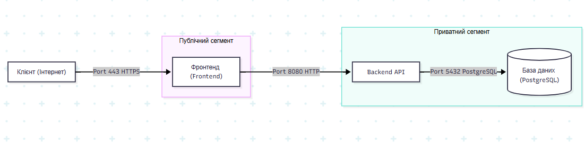

# Звіт з самостійної роботи №15

## Завдання 1. Мережева схема застосунку (Блог-платформа)

Застосунок розбитий на 3 основні сервіси:
1. **Фронтенд** (Публічний сегмент) — єдина точка входу для користувачів.
2. **Backend API** (Приватний сегмент) — обробка бізнес-логіки.
3. **База даних PostgreSQL** (Приватний сегмент) — збереження даних блогу.

### Схема зв'язків, портів та сегментів (ASCII):

## Завдання 2. Режим мережі контейнерів та виявлення сервісів

Для контейнерного середовища обрано режим **user-defined bridge network** (користувацьку міст-мережу).

**Обґрунтування вибору:**  
Режим `bridge` забезпечує повну мережеву ізоляцію контейнерів від зовнішнього світу та дозволяє прокинути назовні лише HTTPS-порт фронтенду (443). Режим `host` не обрано, оскільки він відкриває всі внутрішні порти контейнерів безпосередньо на мережевому інтерфейсі хоста, що порушує вимогу варіанта 3. У користувацькій bridge-мережі працює вбудований **Embedded DNS-сервер**: контейнери автоматично знаходять один одного за їхніми іменами сервісів (наприклад, `http://api:8080` або `postgresql://db:5432`), що позбавляє потреби використовувати прив'язку до конкретних IP-адрес.

## Завдання 3. Таблиця груп безпеки (Security Groups / Network Policies)

| Сервіс | Дозволений вхідний порт | Дозволене джерело (Source) | Сегмент / Примітка |
| :--- | :--- | :--- | :--- |
| **Фронтенд (Frontend)** | `443/TCP` (HTTPS), `80/TCP` (HTTP) | `0.0.0.0/0` (Усі зовнішні користувачі) | Публічний сегмент (єдиний доступ ззовні) |
| **Backend API** | `8080/TCP` | Тільки `Frontend` (контейнер/IP) | Приватний сегмент (ізольовано від інтернету) |
| **База даних (PostgreSQL)** | `5432/TCP` | Тільки `Backend API` (контейнер/IP) | Приватний сегмент (без прямого доступу ззовні) |

## Завдання 4. Перелік метрик та порядок діагностики недоступності

### Перелік метрик моніторингу (4 метрики):
1. **Healthcheck (Статус здоров'я):** Доступність внутрішнього ендпоінта перевірки стану `/health`.
2. **Затримка відповіді (Response Latency):** Час обробки запиту від клієнта до отримання відповіді.
3. **Частка помилок (Error Rate / HTTP 5xx):** Відсоток помилок сервера під час обробки запитів.
4. **Використання ресурсів (Resource Utilization):** Рівень завантаження CPU, RAM та мережі контейнера/вузла.

### Порядок діагностики недоступності з 3 кроків:
1. **Крок 1 (Швидка перевірка стану):** Перевірка статусу контейнерів (`docker ps` або `kubectl get pods`) та результатів їхніх автоперевірок здоров'я (Healthcheck).
2. **Крок 2 (Перевірка мережевого зв'язку):** Перевірка DNS-резолвінгу за іменами сервісів та перевірка доступності внутрішніх портів між контейнерами за допомогою команд `curl` або `nc -zv api 8080`.
3. **Крок 3 (Глибокий аналіз логів та ресурсів):** Перегляд внутрішніх логів застосунку (`docker logs <container_id>`) та аналіз метрик споживання пам’яті/процесора для виявлення системних помилок чи нестачі ресурсів.

## Контрольні запитання

1. **Чому базі даних чи черзі повідомлень зазвичай не варто відкривати порт назовні?**  
   Відкриття порту бази даних у публічний інтернет створює високий ризик атак типу Brute Force, SQL-ін'єкцій та автоматичного сканування вразливостей СУБД для витоку даних. База даних має бути доступною виключно для авторизованого приватного backend-сервісу.

2. **Який режим мережі контейнерів підходить для сервісу без потреби в максимальній ізоляції, і чому це рідко виправданий вибір?**  
   Це режим `host`. Він рідко виправданий, бо повністю позбавляє контейнер мережевої ізоляції (контейнер використовує IP та порти хоста напряму), що створює конфлікти портів між контейнерами та підвищує ризики безпеки.

3. **Яку перевірку варто виконати першою при повідомленні «сервіс недоступний»?**  
   Перш за все потрібно перевірити статус самого контейнера/процесу (чи він запущений і чи проходить Healthcheck), а також перевірити базову мережеву доступність його порту.

